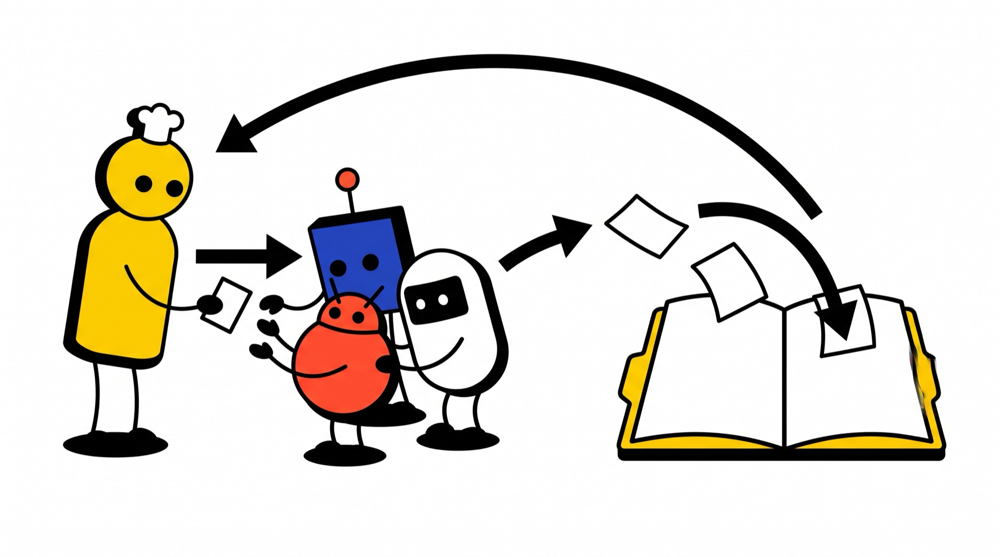
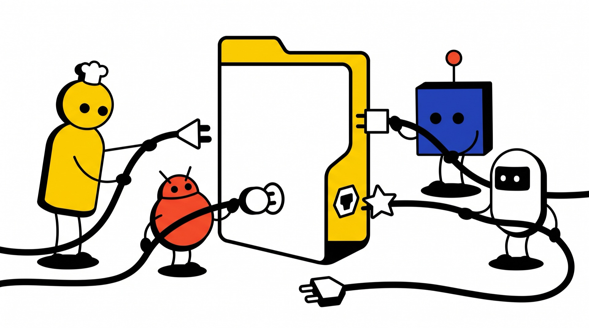

Every AI session I start forgets what the last one learned. So for four months I have been building one folder of plain text files that every AI tool I use reads before it does anything. I call it the Agents workspace. It now runs most of my work, not just the coding.

Here is the whole thing at a glance:

```text
agents/
├── AGENTS.md     rules every agent reads first
├── INDEX.md      a map of what to read when
├── projects/     memory for each project
├── specs/        how things should work now
├── changes/      plans for work in progress
├── workflows/    plan, execute, reconcile
├── skills/       recipes, loaded on demand
├── roles/        what each worker may do
├── adapters/     one small mapping per tool
├── capabilities/ notes on outside tools
├── ai-models/    which model gets which job
├── conventions/  filing and memory rules
└── artifacts/    every report, filed by type
```

It is a git repository of Markdown files. No database, no app, no plugin.

It is also my answer to a question people ask me a lot: how do you lean on agents for so much without a huge bill or sloppy work? Cheap models do narrow jobs, strong models do the parts that need judgment, written rules and checks catch mistakes, and memory means nothing gets rebuilt from scratch. Here is how each folder does its share.

## Why: every session starts from zero

You spend an hour with an agent on a hard problem. It learns why you picked one library over another, which approach failed and what "done" means. Then the session ends, and all of that is gone. The next session is a smart newcomer who knows nothing.

In 1985 Peter Naur wrote an essay called "Programming as Theory Building". His point: the real program is not the code. It is the understanding in the heads of the people who built it, and it leaves when they do.

An AI session is the person who just left, every single time.

There is a second problem. I use Claude Code, Codex, Gemini, OpenCode, Hermes and Cursor, and each keeps its instructions in its own format. If my rules live inside one tool, I lose them when I switch. If I copy them by hand, the copies drift apart.

So the workspace has one job: keep the understanding of the work outside any single session and outside any single tool.

I think of it like a restaurant kitchen. A good kitchen keeps working when the chef on shift changes, because the recipes, rules and notes live in the kitchen, not in one person's head.


## AGENTS.md: one short rulebook every tool reads first

Every session starts by reading one file, `AGENTS.md`. It is the house rules taped to the kitchen wall:

- **Where work goes**: "for a research question, use this skill; for serious multi-step work, use that workflow".
- **Hard gates**: before writing any report, read the filing rules. Before changing project memory, read the memory rules.
- **Boundaries**: what needs my explicit OK, what is private, what must be committed before the session ends, and a house style of plain English with no jargon.

The file stays short on purpose. It works like a router: "for this kind of task, read that file". One giant instruction file would waste context in every session, including the ones that only fix a typo.

In Claude Code, the global instruction file is just a symbolic link (a file that points at another file) to `AGENTS.md`. Other tools load it through their own small adapter. I edit one file, and every tool sees the change.

## projects/ and specs/: memory that outlives the session

This is where the idea that holds everything together comes in: spec-driven development. It is simple. Before you change something, you write down what should be true when you're done. Then you make the change. Then you check the result against what you wrote, and update the write-up so it describes how things really are now. That write-up is the spec.

For agents, a spec is a fixed target. A fresh session doesn't have to guess what "done" means or remember last week's chat. It reads the spec, compares it to reality and gets to work.

The workspace runs on its own specs:

```text
specs/
├── spec-workflow/      how big jobs run
├── project-memory/     what each memory file is for
├── model-delegation/   who picks which model
├── research/           what a research run must produce
└── ...
```

Each folder holds a `spec.md` with plain rules about what must be true. Skills and workflows point back to the spec they follow. The `research` skill answers to `specs/research/`, and every model choice answers to `specs/model-delegation/`. That's why I call specs the glue: they are the current truth, and everything else points to them.

Each project I work on gets the same treatment at a smaller scale. A project is a folder of memory for one code repository:

```text
projects/
├── personal-website/     this site
├── claude-agent-watch/   a Claude Code mod
└── ...
```

And here is what one holds:

```text
personal-website/
├── SPEC.md        what we're building, and "done"
├── STATE.md       what's true now; resume here
├── DECISIONS.md   each choice and why
├── AGENTS.md      house rules for this project
└── artifacts/     research and drafts
```

The three main files work as a set. `SPEC.md` is the target. `STATE.md` says where things stand against it, and opens with a section called "Resume here". `DECISIONS.md` explains each choice, including what I rejected. The code repository has a small link (ignored by git) back to this folder, so an agent that opens the code also finds the memory.

A real example from this website. The research first recommended plain CSS. I pushed back: Tailwind lets me prototype faster, its default styles can be removed, and it likely costs fewer AI tokens. A second round of research checked my argument and agreed. `DECISIONS.md` now records the first recommendation, my pushback, the evidence and the final call. A fresh agent reads that and won't suggest plain CSS again.

Each fact has one home that other files link to, and git is the changelog: every commit message has to say *why*. Memory only helps if it's current, so after ad hoc work I run the `memory-reconcile` skill. It checks whether the work changed anything the memory files claim, and fixes what went stale. If I didn't clearly ask for changes, it only reports and asks once.


## artifacts/: every report filed where I can find it

Agents write a lot. Without rules, it all ends up next to the code with names like `notes2_final.md`. So every generated document goes in the shared `artifacts/` folder or in a project's own one. The filing rules have their own folder, and agents must read them before writing any report.

```text
artifacts/
├── investigations/   research runs
├── audits/           checks of how things really work
├── handoffs/         notes for a future session
├── docs/             guides people will read
└── ...
```

The drawers are fixed. If nothing fits, there's `misc/`, but agents may not invent new drawers. Every file name follows one pattern:

```text
26-09-29_19-50__audit__codex_web_browser_smokes_gpt-6-sol.md
```

That's the date and time, the type of document, a short title and the model that wrote it. A big research run gets a folder named the same way. Every file also starts with a small header saying what it's for and which files it relates to, with a one-line reason for each link.

It sounds like bureaucracy, but I can find any report from months ago and see which model wrote it, so I know how much to trust it. One more rule: artifacts show how work happened. What to believe now lives in the memory files and specs.

## changes/ and workflows/: big jobs that survive a crash

For small jobs, I just ask. For serious work, with several steps, several files and real risk, I use a three-step workflow. Each step is its own skill:

```text
plan-create     dig in, get my OK, write the plan
     ↓
plan-execute    a fresh session does the work
     ↓
plan-reconcile  a fresh session updates memory
```

1. **`plan-create`.** A strong model investigates until the unknowns are gone, then shows me a readable proposal. Nothing becomes a plan until I approve it.
2. **`plan-execute`.** A *fresh* session reads the plan, sends small jobs to workers and checks every result.
3. **`plan-reconcile`.** Another fresh session reads what happened and updates state, decisions and specs.

The idea borrows from OpenSpec, an open-source tool for this style of work. Each job gets a change folder, which works like the order ticket in a kitchen. Here is a real one, from the change that added my shared loose-ends list:

```text
changes/260808_1125__global-loose-ends/
├── PLAN.md            scope, allowed files, checks
├── EXECUTION_LOG.md   decisions and failures
├── RESULT.md          what happened
├── MEMORY_DELTA.md    what memory should change
├── specs/loose-ends/  the proposed spec
└── ...
```

`PLAN.md` lists which files may be touched and which may not, what to read first and how to verify the result. The log records decisions and failures, not a chat transcript. The `specs/` folder inside holds the proposed spec. When the change landed, reconcile copied it into the main `specs/loose-ends/`, where it is now the current rule. That's spec-driven development end to end: propose the spec, build it, merge the spec.

The rule that makes this work: **no step relies on chat history.** Each step starts from files and ends by writing files. If a session crashes, or I come back a week later, the next step picks up from the folder.

One more rule I like: **the lead writes the important words.** When the exact wording is the deliverable (a spec, a rule, a memory entry), the lead agent writes it itself. Workers may paste it into place. They may never write or rephrase it.



## skills/: recipes the agent loads only when it needs them

A skill is a written procedure that an agent loads only when the task calls for it, which keeps every session's context small. There are 21 right now. You've already met four: the three planning steps and `memory-reconcile`. Here are a few others:

```text
skills/
├── research/                       one saved report
├── research-deep/                  several rounds
├── browser-deep-research-prompts/  ChatGPT, Claude
├── model-bakeoff/                  one task, many models
├── web-search/                     a ladder of tools
└── ...
```

- **research** splits a broad question into topics, sends each to workers and always ends with one saved report. A chat answer alone never counts.
- **research-deep** is for questions that need several rounds. Between rounds, the lead does its own checks and decides what the next round should look at.
- **browser-deep-research-prompts** writes research prompts that a browser agent runs on the ChatGPT and Claude websites, then saves the answers in one folder. Every run spends my quota, so it first asks how many prompts I want and which mode fits each. It never uses ChatGPT's Deep research mode, which scored lowest in my own tests.
- **model-bakeoff** gives the same task to several models and compares speed and quality. It's how I test a new model before trusting it with real work.
- **web-search** only runs when I ask. It climbs a ladder of stronger search tools when built-in search isn't enough.

Skills stay short. The facts they depend on live in `capabilities/`, which comes later.

## roles/ and ai-models/: strong where it counts, cheap everywhere else

This is the part that answers the cost and quality question.

Most of my sessions have one lead agent and a few workers. The lead is the head chef: it owns the plan, the judgment calls, the final checks and the memory. Workers are line cooks with narrow stations. The lead runs on a strong model. Most workers don't.

```text
roles/
├── task-worker-tiers.md   rules for every worker
├── task-explore.md        read and report, nothing else
├── task-execute.md        edit only the named files
├── task-orchestrator.md   run one phase, one layer deep
└── ...                    plus "high" versions
```

Explore and execute each come in a regular and a high version. Regular runs the cheaper model in that tool, high a stronger one. Every job goes out as a packet: one goal, the files to read, what may change, how to check the result and when to stop. A few rules hold everywhere:

- **Pick the cheapest worker that can do the job.** If the job is tiny, the lead does it itself, because launching a worker would cost more. Price only matters once the model can do the job and the lead can check the result.
- **Workers cannot start other workers.** One layer deep, always.
- **Three serious failed attempts, then stop** and report "blocked" instead of guessing.
- **Packets stay under half of the model's working memory.** A worker that runs out of room still returns a confident answer, just a worse and partly invented one.
- **Packets have a clock.** A regular worker gets checked at about three minutes and cancelled at four, double that for slow models.


Which model does each job? That lives in `ai-models/`:

```text
ai-models/
├── delegation-briefing.md  the only file that picks models
├── SELECTION.md            value and reliability notes
├── EFFORTS.md              how hard each model should think
├── data/                   benchmark snapshots
└── ...
```

The delegation briefing is the only place a model gets chosen. Everything else points to it, so when a better model comes out, I change one file.

Every model in the briefing carries four labels, built from public benchmark data:

| Label | What it decides |
|---|---|
| Cost: cheap, mid, premium | How many run at once |
| Skill: weak, solid, strong | How big a packet it gets |
| Guessing: low, medium, high | Which jobs it gets, and how hard the lead checks |
| Speed: fast, normal, slow | Deadlines |

Guessing is the label I didn't expect to matter. It measures how often a wrong answer was a confident guess instead of "I don't know". Some of my strongest models score high: Opus knows a lot, but when it's wrong, it rarely admits it. A model that guesses a lot can still run in numbers, but only on jobs the lead can check quickly, like "does this file say X". It never gets judgment calls or long-term memory.

Cost sets the count: three to eight cheap workers at once, two to four mid ones, one to three premium ones. A model with a tight request limit gets fewer, whatever its price.

Here's how that plays out in Claude Code. The lead is Opus. Regular workers run Haiku at high effort, high workers run Sonnet at high effort, and the orchestrator runs Opus at medium. Each sits at its effort sweet spot: the last setting before one more point of quality costs several times more. Haiku at high beat Sonnet at medium on a coding benchmark for under half the cost. Sonnet at high beat the Opus setting it replaced, at about the same cost.

On a subscription, the real limit is quota, not dollars. Every Claude model draws on the same weekly limit, my scarcest budget. So in Claude Code I delegate to keep the lead's context clean or to run things in parallel, not to save money. For a big, cheap fan-out, the briefing tells the agent to suggest Codex or OpenCode workers instead. Codex's cheapest model is great for quick lookups, but did so badly on a terminal benchmark that it never edits files.

One more rule keeps surprises out. If a model hits a rate limit, a worker may switch once to a model in the same price row and must say so. It never moves up a price row on its own.

That's the whole answer: strong models where judgment matters, cheap models for narrow work I can check, written labels so no agent picks a model from memory, and a lead that checks everything before it counts.

## adapters/: six tools that share one rulebook and pass work around

The rule at the top of `AGENTS.md`, in short: **tools adapt to the workspace. The workspace never bends to a tool.**

Each AI tool gets an adapter: a small mapping that points the tool at the shared files and translates them into the format it expects.

```text
adapters/
├── adapter-contract.md         rules for every adapter
├── claude-code.md              how Claude Code maps in
├── claude-code.divergences.md  approved differences
├── codex.md
├── opencode.md
└── ...                         Cursor, Gemini, Hermes
```

The adapter is only a loader. It may say "this subagent runs this model, now go read the role file". It may not copy the role's rules, because copies drift. When a tool can do something the workspace doesn't cover, I either add it to the workspace or record it as an approved difference. Nothing gets quietly ignored.

The `sync-tool-adapter` skill keeps each tool in line. It compares the tool's real settings with the workspace in both directions, lists every difference, and I decide each one. It only touches the tool it runs in, because only that tool can see its real settings and confirm a change worked.

Adapters connect each tool to the workspace. Bridge skills connect the tools to each other. Any tool can hand a bounded job to another through its command line:

```text
skills/
├── task-claude/    hard reasoning, careful review
├── task-codex/     OpenAI models, web research
├── task-gemini/    fast, cheap Google model
├── task-opencode/  cheap models in big batches
└── task-hermes/    browser, Mac tools, scheduling
```

Every bridge works the same way: a self-contained packet, a model pinned from the delegation briefing, and a child session that reads the same `AGENTS.md`. A job that starts in Claude Code and runs in Codex follows the same rules.

Asking several providers pays off most when they disagree. For this website, all three picked Astro: a good sign, not proof. On one browser feature, one model claimed support that the official compatibility data didn't show, so I threw that claim out. The disagreements told me where to look closer.

Two limits keep this safe:

- **It never happens on its own.** Handoffs only run when I ask. A skill suggesting one, or a tool failing, is not a reason.
- **Child sessions don't spawn crowds.** A session started this way can't start its own workers unless I allow it. Ten child sessions that each start ten workers is a hundred agents, so that budget is set before launch.



## capabilities/: fact sheets that keep the recipes short

A capability is a note about something an agent can reach outside its own context: a command-line tool, an MCP server, a browser or an API. It says what the thing is good for, what needs my approval and how to check its results.

```text
capabilities/
├── codex-cli.md    what it's good at, its limits
├── gemini-cli.md
├── opencode/       CLI and session guides
├── web/            which search tool for which job
└── ...
```

Skills say how to do a job. Capabilities hold the facts. When a tool changes its flags, I fix one fact sheet instead of every recipe that uses it.

## Not just for code

The same setup works for most of my work that involves thinking, not just typing.

- **Research.** Any bigger decision gets the same fan-out and ends as a saved report with sources, not a chat I'll never find again.
- **Loose ends.** Unfinished threads go on one shared list, each with an ID, what I found so far and the exact next action. Weeks later I say "resume" with that ID, in any tool, and pick it up cold.
- **Permissions.** Routine local work (reading files, running commands, public research) runs without asking me. Anything that touches an account, money or a public post needs my OK in the current chat.
- **Personal work.** Same pattern, but anything sensitive lives in a separate private repository.

In every case I'm the architect and the reviewer. I set the question, check the work and make the call. The agents do the reading, the comparing and much of the typing.

## A worked example: this website in a day

I built this site today. Research started just after noon, the first version shipped about an hour and a half later, and a second version about 40 minutes after that. The speed didn't come from AI typing fast. It came from everything above.

1. **Research (about 9 minutes).** 21 runs worked in parallel. Six questions each went to three models from three different companies, and three more runs checked my hosting account and gathered notes about my background. It all landed as one research folder with a summary table.
2. **Decisions.** The summary became numbered decisions, each with the options I rejected. A ChatGPT review of the plan added more.
3. **Design.** Agents built three home page mockups. I picked one, they built variants, and I picked again.
4. **Build.** A strong model ran the work and did the visual pass, while cheaper models scaffolded pages. Work happened on a branch, I reviewed it, and it merged to go live.
5. **Trouble.** Production deploys kept timing out on the hosting provider's API. The fix is now a numbered decision, with the manual retry steps in `STATE.md`. Agents could read my hosting dashboard, but DNS and domain changes stayed with me, with exact click steps.

The website's memory folder now holds a spec, a dozen numbered decisions, a state file and every research report. The next session starts from "Resume here".

## What I've learned

**Agents guess.** Even good ones. A worker will tell you, with full confidence, that a file says something it doesn't. So every important claim gets checked against the source, and the more a model tends to guess, the narrower its jobs.

**Review is not optional.** I picked the design and pushed back on the CSS plan. Models are better at writing code than at judging how a page looks.

**Updating memory is part of the work.** When I changed my mind on Tailwind, older notes still said plain CSS. An agent that reads both gets confused. The job isn't done until the notes match.

**Some things stay mine.** Anything that touches accounts or money, the final call on design and wording, and deciding what is worth doing at all.

## Start small

You don't need six tools or 1,400 commits. Here is how I would start:

1. **Make one folder and put it in git.** Add a short `AGENTS.md` with the rules you keep repeating to every AI session, and point your tool at it.
2. **Keep a `DECISIONS.md` for one project.** Each time you make a choice, write what you picked, what you rejected and why. Have the agent read it at the start of every session.
3. **Turn one repeated explanation into a skill.** Pick the thing you explain to agents most often and write it down as steps. Next time, just say "follow that file".

Then use it for a week and fix whatever annoys you. That's how mine grew. Not from a grand design, but from writing down the thing I had just explained for the third time.
