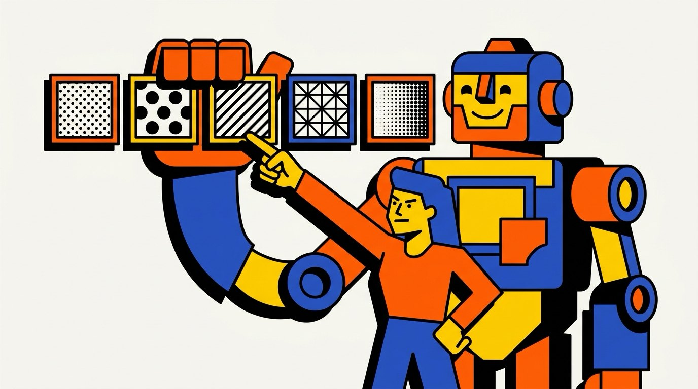
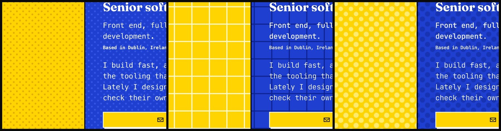
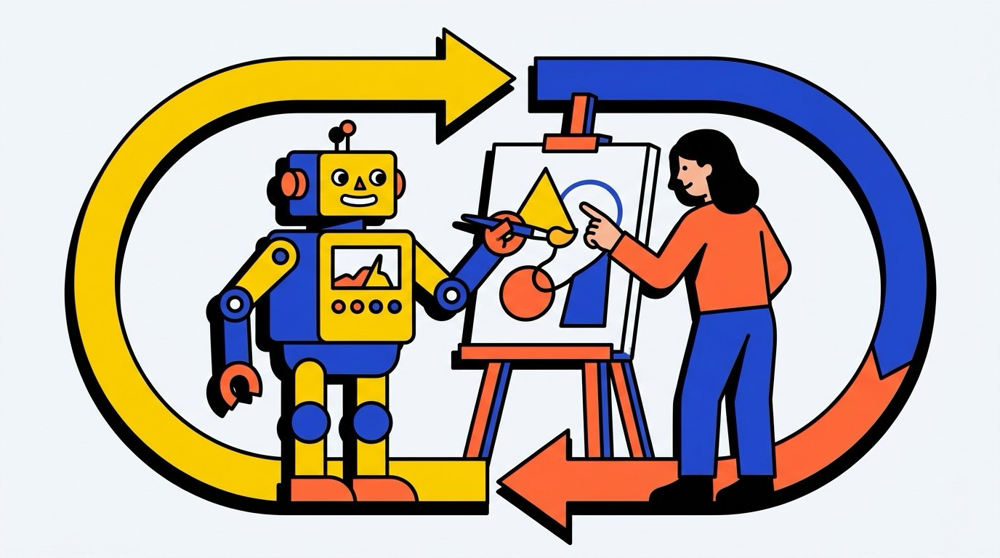
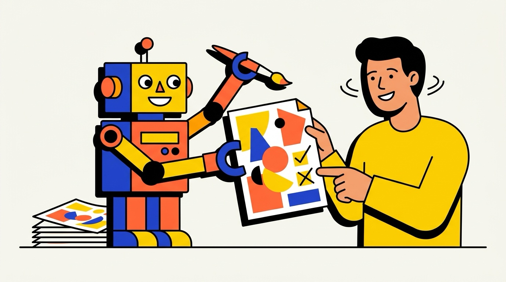

In late September a [music video](https://www.youtube.com/watch?v=5EoO5413dBY) went around. It is 2 minutes 37 seconds of fast, sharp, well-timed visuals, and it was made with Claude Opus 5.5 in Claude Code. Some people read it as "one prompt, and the AI did the rest."

I get why. AI has come a long way, and it is tempting to think the human can step out of the loop now.

I don't think so. The video is a good example of why.

## What really went into the video

The song is about P(doom). That is short for "probability of doom": your own guess at how likely it is that AI ends badly for humanity. "What's your p(doom)?" has become an in-joke in AI circles.

The words of that song came from people, and over a long time. A Udio user called MusicPerson wrote the opening verse and chorus. A person named osmarks wrote most of the rest in 2024, with lines suggested on the EleutherAI Discord. Both are credited in the [project's repo](https://github.com/mexicat/pdoom-video). The singing was AI-made, but the lyrics were not a prompt.

Then there is the video itself. Its author, [@_mexicat](https://x.com/_mexicat/status/2103904518929055853), wrote a thread about it, and it says plainly "this is not a one-shot prompt." The author started with a vague vision and sharpened it over a long conversation with Claude, with clear rules: maximalist type, a limited palette, no literal retelling of each verse, lyrics always in sync. The thread counts "tens of small and big adjustments and changes of trajectory."

One example I like. The first draft showed the p(doom) number in a box in the corner, always on. The author asked for it to be woven into the scenes instead. The video got far more interesting.

The repo keeps a revision log too. In one round a realistic eye was removed because "the client found it uncanny." There is a typography pass, a color fix, and hand-set timings where the automatic lyric sync failed.

That is a director at work, with a very fast crew.

## The same thing happened on my site

I felt this myself this week. The first live version of this site took about 90 minutes, from nothing to published. The motion and texture system, the animated dots and the text reveals, took one afternoon, about two hours and fifteen minutes from my first question to shipped.

Fast, yes. But the speed was not the story. The loop was.

I never asked for one perfect result. I asked for options. Agents built each option on a throwaway copy of the real site, where I could switch effects on and off from the web address. I looked at them on the real pages and told them what was wrong. Then they tried again.

Here is what that sounded like, in order:

- **Round 1, nine background textures.** The dots on the yellow were darker than the yellow, which made the black text harder to read. I asked for lighter dots, and for faster movement, because I couldn't even tell they were moving.
- **Round 3.** The agents pushed the contrast up. My verdict: "way too much... basically unusable." So round 4 landed in between, with a contrast knob I could set myself.
- **Round 5.** My favorite dots looked blurry. "It hurts my eyes." The fix was crisp, stepped dots.

The text reveal went the same way. A flashy reveal on the big headings "screams too much." A quiet, terminal-style block reveal on the small monospace text was "minimal and unobtrusive," so that one shipped.

I said no to a lot. Scroll fade-ins felt generic. A dot that follows the cursor was too much. A yellow progress bar added ugly extra space.

Once I even asked for the wrong thing. I wanted the whole blue title band to shrink into a thin bar, and the first build only shrank the nav. We caught it in review and built the right one next.

Across it all: 5 rounds of backgrounds, 3 of motion and 3 of small touches, plus several hundred screenshots. The agents built and checked every option for contrast, reduced motion and layout shifts. Every decision was mine. If you are curious, the whole lab is frozen in a [public tag](https://github.com/sgarcia-dev/sergeigarcia.com/tree/lab/motion-2026-10-13).

## The point

@_mexicat said it better than I can: these tools raise the floor. A decent-looking result is nearly instant now. The ceiling is still set by having a good creative vision.

I would add one thing. The ceiling also depends on feedback, because vision is not a single moment. It is the dozens of small "no, not like that" along the way.

Here are the habits that worked for me:

1. **Ask for options.** Three versions teach you more than one. You find out what you want by seeing what you don't.
2. **Judge on the real thing.** A mockup lies. Try each option in the actual site, on real content.
3. **Push back, and ask for pushback.** Tell the agent when it is wrong. Ask it to disagree with you, too.
4. **Be specific, and say why.** "The dots are too dark" is fine. "The dots are too dark, and I can't read the text on top" is much better. The reason lets the agent fix the cause, not just the symptom.

AI did a huge amount of work on my site, and it still needed me to say what was wrong, over and over. That is not a flaw in the tool. It is the job, and it is the fun part.

So if you have been waiting for AI to need you less, relax. It needs you in a different place, and that place is the one where taste lives.
